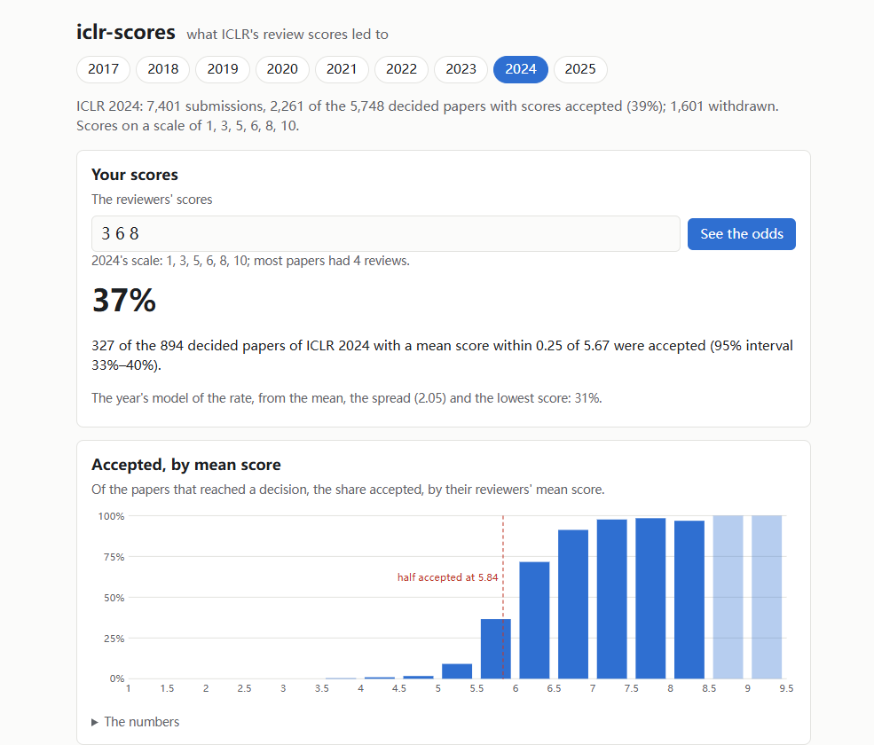

<div align="center">

# iclr-scores

**What ICLR's review scores led to, year by year.** For every ICLR from 2017 to 2025: how often a paper was accepted
at each mean score, the mean where half were, what disagreement between reviewers did, who withdrew, which topics
fared better, and the odds for your own scores.

<a href="https://github.com/zch6a/iclr-scores/actions/workflows/ci.yml"></a>


<a href="LICENSE"></a>

**English** · [简体中文](README.zh-CN.md)

</div>

---

<p align="center"><a href="https://zch6a.github.io/iclr-scores/"></a></p>
<p align="center"><b><a href="https://zch6a.github.io/iclr-scores/">zch6a.github.io/iclr-scores</a></b></p>

```console
$ uvx --from git+https://github.com/zch6a/iclr-scores@v0 iclr-scores odds 6 6 8 5 --year 2025
ICLR 2025, scores 6 6 8 5 (mean 6.25, spread 1.09):
  1,667 of the 2,047 decided papers with a mean within 0.25 were accepted: 81% (95% interval 80%-83%)
  the year's model (mean, spread, lowest score) gives 81%
  half the papers were accepted at a mean of about 5.81
  a rate of the past, not a prediction: decisions also rest on the reviews' text, the discussion and the area chair
```

## What it shows

From 28,444 papers that reached a decision with their reviewers' scores (ICLR 2017–2025):

- **The line is steep.** At ICLR 2025, papers with a mean score of 5.0–5.5 were accepted 10% of the time, 5.5–6.0
  32%, 6.0–6.5 77%, 6.5–7.0 94%. Half were accepted at a mean of about 5.8, and that point has stayed between 5.8 and
  6.1 every year but 2020 (5.4, on a 1/3/6/8 scale).
- **Disagreement cuts both ways.** At the same mean, a paper whose reviewers disagreed (a spread of scores above the
  year's median) did better below the line and worse above it: at ICLR 2025, with a mean of 5.0–5.5, 15% accepted when they disagreed and 4% when they agreed; with
  6.0–6.5, 68% against 90%.
- **Withdrawals are of the low scores.** In 2025 more than half the papers with a mean under 4.5 were withdrawn, 19% at
  5.0–5.5, almost none above 6.5.
- **Topics differ.** Over all years, 25% of the papers labelled CNNs and 27% of those on federated learning were
  accepted, against 51% on diffusion models and 62% on 3D scenes (labels from the papers' keywords; about half the
  papers have one).

For each year the page shows the acceptance rate by mean score, mean scores by outcome, agreement, withdrawals and
topics with their 95% intervals, with a calculator; every chart's numbers are also in a table, and the year and scores
are kept in the address, so a link shows the same.

## Where the numbers come from

- **The data**: the [ICLR dataset](https://github.com/berenslab/iclr-dataset) of Rita González-Márquez and Dmitry
  Kobak (MIT licensed), a scrape of ICLR's submissions on OpenReview (all but the few with a placeholder abstract),
  pinned to one version by commit, size and SHA-256. Only the year, the decision, the reviewers' scores and the topic label are read; titles, abstracts and
  authors are not. Please cite their paper: *Learning representations of learning representations*, DMLR workshop at
  ICLR 2024, [arXiv:2404.08403](https://arxiv.org/abs/2404.08403).
- **Decided** means accepted (oral, spotlight or poster), rejected, or (2017–2018) invited to the workshop track;
  withdrawn and desk-rejected papers are counted apart.
- **The odds** for a set of scores: the share accepted among that year's decided papers whose mean score is within
  0.25 (widened until there are 30 papers), with a Wilson interval, and a logistic model of the year's decisions from
  the mean, the spread and the lowest score.
- **Published**: counts and rates over groups of papers, nothing about any one paper; no paper, author or reviewer is
  named.

## Use it

```bash
uvx --from git+https://github.com/zch6a/iclr-scores@v0 iclr-scores odds 6 6 8 5 --year 2025          # --json for scripts
uvx --from git+https://github.com/zch6a/iclr-scores@v0 iclr-scores years
uvx --from "iclr-scores[build] @ git+https://github.com/zch6a/iclr-scores@v0" iclr-scores build --out site
```

`@v0` is the latest release (drop it for the main branch). `odds` and `years` read the published statistics (a 23 KB
file from the site), or a built one with `--stats` (the file, or the site folder it is in).
`build` downloads the pinned file (49 MB), computes everything, deletes it, and writes the page with its data.

## Limits

- Scores only: the dataset has no reviewer confidence, no scores from before the rebuttal and no review text, so
  none of that is here. The scores are those on OpenReview when the dataset was scraped, after the decisions.
- The scale changed (1–10 in 2017–2019 and 2021; 1/3/6/8 in 2020; 1/3/5/6/8/10 since 2022), so years are shown
  apart and a calculator's scores are checked against the year's scale.
- ICLR 2026 is in the dataset without scores or decisions yet; it will be added when a version of the dataset has
  them. Most other conferences publish the reviews of accepted papers only, which cannot show a rate of acceptance.
- A rate of the past is not a prediction: decisions also rest on the reviews' text, the discussion and the area chair.

## Also in this toolkit

[venue-atlas](https://github.com/zch6a/venue-atlas) maps what each venue's papers are about ·
[paper-impact](https://github.com/zch6a/paper-impact) shows their citations ·
[submit-check](https://github.com/zch6a/submit-check) checks a submission before the deadline.

## License

MIT. The data is the ICLR dataset by Rita González-Márquez and Dmitry Kobak (MIT), from OpenReview.
