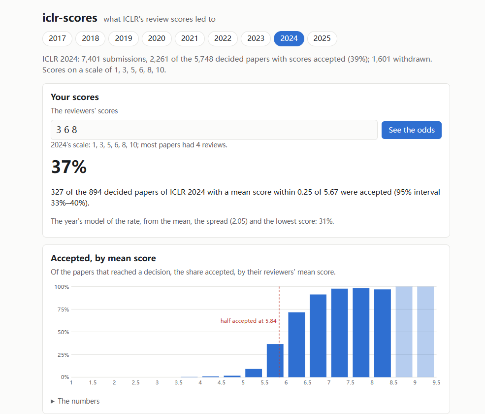

<div align="center">

# iclr-scores

**ICLR 的审稿分数最后换来了什么结果，按年份看。** 2017 到 2025 年的每一届 ICLR：每个平均分上的录用比例，录用一半时的平均分，审稿人意见不一会带来什么，哪些论文被撤回，哪些主题录用得多，以及你手上这组分数在往年的录用比例。

<a href="https://github.com/zch6a/iclr-scores/actions/workflows/ci.yml"></a>


<a href="LICENSE"></a>

[English](README.md) · **简体中文**

</div>

---

<p align="center"><a href="https://zch6a.github.io/iclr-scores/"></a></p>
<p align="center"><b><a href="https://zch6a.github.io/iclr-scores/">zch6a.github.io/iclr-scores</a></b></p>

```console
$ uvx --from git+https://github.com/zch6a/iclr-scores@v0 iclr-scores odds 6 6 8 5 --year 2025
ICLR 2025, scores 6 6 8 5 (mean 6.25, spread 1.09):
  1,667 of the 2,047 decided papers with a mean within 0.25 were accepted: 81% (95% interval 80%-83%)
  ...
```

## 能看到什么

数据是 ICLR 2017–2025 年有审稿分数、并且有最终结果的 28,444 篇论文：

- **录用线很陡。** ICLR 2025 平均分在 5.0–5.5 的论文录用了 10%，5.5–6.0 是 32%，6.0–6.5 是 77%，6.5–7.0 是 94%。录用一半的位置在平均分 5.8 左右，除了 2020 年（5.4，那年的分数只有 1/3/6/8 四档），每年都在 5.8 到 6.1 之间。
- **意见不一，有利也有弊。** 平均分相同时，审稿人意见分歧大的论文（分数的标准差高于当年的中位数），在线下更容易被录用，在线上反而更难：ICLR 2025 平均分 5.0–5.5 的论文，意见分歧时录用 15%，意见一致时只有 4%；平均分 6.0–6.5 的，分歧时 68%，一致时 90%。
- **撤稿集中在低分。** 2025 年平均分低于 4.5 的论文一半以上被撤回，5.0–5.5 的有 19%，6.5 以上几乎没有。
- **主题之间有差别。** 所有年份合起来，标为 CNN 的论文录用了 25%，联邦学习 27%，扩散模型 51%，三维场景 62%（主题标签来自论文关键词，大约一半的论文有标签）。

网站上每一年都有这些图：按平均分的录用比例、各结果的平均分分布、审稿意见是否一致、撤稿比例、带 95% 区间的主题录用率，还有一个计算器。每张图的数字也都列在表格里，年份和分数记在网址里，把链接发给别人，看到的是同一个画面。

## 数字从哪来

- **数据**来自 Rita González-Márquez 和 Dmitry Kobak 整理的 [ICLR 数据集](https://github.com/berenslab/iclr-dataset)（MIT 许可），它抓取了 OpenReview 上的 ICLR 投稿（只去掉了少数摘要是占位文字的）。这里按提交、文件大小和 SHA-256 固定在其中一个版本，只读年份、结果、审稿分数和主题标签，不读标题、摘要和作者。使用时请引用他们的论文：*Learning representations of learning representations*，ICLR 2024 DMLR workshop，[arXiv:2404.08403](https://arxiv.org/abs/2404.08403)。
- **有最终结果**指被录用（口头报告、spotlight 或海报）、被拒，或者（2017–2018 年）被邀请到 workshop；撤稿和桌拒单独统计。
- **计算器**的做法：在那一年有最终结果的论文里，找平均分相差不超过 0.25 的（不足 30 篇就放宽），看其中录用的比例，并给出 Wilson 区间；另外给出用当年的结果拟合的逻辑回归（平均分、分歧大小、最低分）的结果。
- **公开的只有按组统计的数量和比例**，不涉及任何一篇论文，也不点名任何作者或审稿人。

## 使用

```bash
uvx --from git+https://github.com/zch6a/iclr-scores@v0 iclr-scores odds 6 6 8 5 --year 2025          # --json 给脚本用
uvx --from git+https://github.com/zch6a/iclr-scores@v0 iclr-scores years
uvx --from "iclr-scores[build] @ git+https://github.com/zch6a/iclr-scores@v0" iclr-scores build --out site
```

`@v0` 是最新的发布版（去掉它就用主分支）。`odds` 和 `years` 读取网站上公开的统计结果（一个 23 KB 的文件），也可以用 `--stats` 指定自己构建的文件（或它所在的网站文件夹）。`build` 会下载固定版本的数据文件（49 MB），算完就删掉，再把网页和数据一起写出来。

## 局限

- 只有分数：数据集里没有审稿人置信度、rebuttal 之前的分数和审稿正文，所以这些都不做。分数是数据集抓取时 OpenReview 上的分数，也就是出结果以后的分数。
- 评分刻度变过（2017–2019 年和 2021 年是 1–10，2020 年是 1/3/6/8，2022 年起是 1/3/5/6/8/10），所以各年分开展示，计算器也会检查输入的分数是否在那一年的刻度上。
- 数据集里已经有 ICLR 2026，但还没有分数和结果，等数据集出了带这些信息的版本再加。其他会议大多只公开录用论文的审稿，算不出录用比例。
- 往年的比例不是预测：录用还取决于审稿正文、讨论和领域主席的判断。

## 同一套工具里的其他项目

[venue-atlas](https://github.com/zch6a/venue-atlas) 把每个会议的论文按内容画成地图 · [paper-impact](https://github.com/zch6a/paper-impact) 看它们的引用 · [submit-check](https://github.com/zch6a/submit-check) 在截稿前检查投稿。

## 许可证

MIT。数据来自 Rita González-Márquez 和 Dmitry Kobak 的 ICLR 数据集（MIT 许可），原始内容来自 OpenReview。
